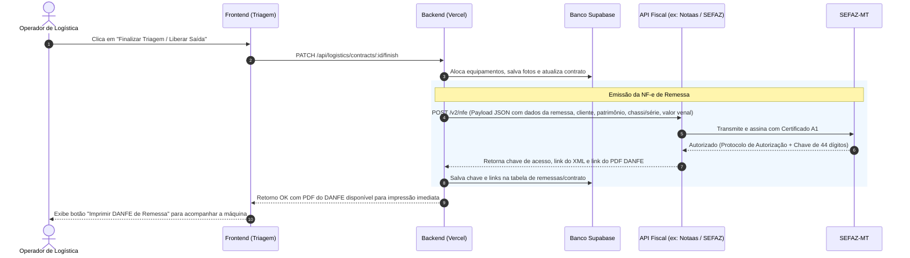

# Análise Técnica e Regulatória: Emissão de Nota Fiscal de Remessa (NF-e Modelo 55)

**Data:** 30/10/2026  
**Contexto:** Necessidade de emissão de Nota Fiscal Eletrônica de Remessa de Ativo Imobilizado para Locação (conforme modelo DANFE anexo) ao finalizar a triagem de saída de equipamentos.  
**Autor:** Engenharia de Software / RentDesk - C3Loc  

---

## 1. O que é o documento apresentado no anexo?

O documento anexado trata-se de um **DANFE (Documento Auxiliar da Nota Fiscal Eletrônica - Modelo 55)**:
- **Modelo:** 55 (NF-e de mercadorias/bens transmitida à SEFAZ Estadual — no caso, SEFAZ-MT).
- **Natureza da Operação:** *REMESSA DE BEM DO ATIVO IMOBILIZADO*.
- **Emitente:** ALTO MASTER LOCADORA DE EQUIPAMENTOS LTDA (Sorriso/MT) — CNPJ `48.477.385/0001-09`, IE `00139683372`.
- **Destinatário:** CONSORCIO CENTRO DE EVENTOS MT (Cuiabá/MT) — CNPJ `62.314.798/0001-01`.
- **Dados do Item:**
  - Código: `01`
  - Descrição: `Plataforma elevatoria, PATRIMONIO: PAD0014, modelo 800AJ, série 0300118508`
  - NCM: `84272090`
  - CST/CSOSN: `0400` (Não tributada pelo Simples Nacional)
  - CFOP: `5554` (ou `5908` / `6908` para contrato de locação)
  - Unidade: `UN`, Quantidade: `1`
  - Valor Unitário / Total: `R$ 330.000,00` (Valor patrimonial/venal do bem para fins de trânsito e seguro, não é o valor da locação).
- **Tributação (ICMS):** R$ 0,00 (Operação de remessa com não incidência / isenção de ICMS conforme legislação estadual RICMS/MT e STF).
- **Informações Complementares:** Detalha a não incidência do imposto e o endereço da obra de destino do cliente.

---

## 2. O Asaas atende a essa emissão de Remessa?

### ❌ Resposta Direta: NÃO via API do Asaas

1. **Escopo da API de Notas Fiscais do Asaas (`/v3/invoices`):**
   - A API do Asaas foi projetada **estritamente para NFS-e (Nota Fiscal de Serviços Eletrônica)** integrada com prefeituras municipais para prestadores de serviço e cobranças de faturas.
   - O Asaas **não possui endpoint de emissão de NF-e (Modelo 55 - Mercadorias/Ativo/SEFAZ Estadual)** em sua API REST.
2. **ERP "Base by Asaas":**
   - O Asaas possui uma ferramenta separada de ERP adquirida/integrada (Base ERP) que permite preenchimento manual em tela de NF-e de produtos, mas **não há API pública integrada à conta financeira para geração automatizada de NF-e modelo 55 via backend** no mesmo fluxo de cobrança.
3. **Diferença de Natureza Fiscal:**
   - **NFS-e (Municipal / Asaas):** Tributa o serviço/locação cobrado do cliente (ex: fatura de locação de R$ 3.500,00 emitida após o pagamento).
   - **NF-e de Remessa (Estadual / SEFAZ):** Acoberta o **transporte físico** do maquinário em rodovias até a obra do cliente, informando o patrimônio físico e valor venal da máquina (ex: R$ 330.000,00), sob fiscalização da Polícia Rodoviária e Postos Fiscais da SEFAZ.

Portanto, **é inviável utilizar a API atual do Asaas para emitir a NF-e de Remessa**.

---

## 3. Pesquisa de Soluções Gratuitas com o Certificado A1 já configurado

Considerando que você **já possui o Certificado Digital A1 (.pfx / .p12) configurado no backend (hospedado na Vercel)**, avaliamos as duas formas possíveis de viabilizar a emissão sem custo (gratuita):

### Opção A: API Fiscal REST com Plano Gratuito Vitalício em Produção (Notaas)
* **Status:** **Existe e é viável!**
* **Plataforma:** **Notaas** (`notaas.com.br`)
* **Modelo Gratuito:**
  - Possui um **plano Free permanente** que permite emissão de NF-e (Modelo 55) em **ambiente de produção real com valor fiscal**, sem necessidade de cartão de crédito.
  - Franquia de até **20 a 50 notas fiscais/mês** gratuitas (ideal para o volume de locações de maquinário pesado).
  - Inclui 1 CNPJ, webhooks, ambiente de sandbox ilimitado e emissão via API REST simples em JSON.
  - O Certificado A1 pode ser enviado para a plataforma uma única vez pelo painel ou consumido via API.
  - O retorno da API já traz a nota autorizada na SEFAZ-MT, o XML assinado e a URL do PDF do DANFE pronto para impressão na triagem.

### Opção B: Comunicação Direta com os WebServices da SEFAZ-MT via Node.js (Open Source / 100% Gratuito)
* **Status:** **Possível, mas com restrições críticas na Vercel Serverless**
* **Como funciona:**
  - Usar bibliotecas Node.js de código aberto, como o **`nfewizard-io`** (projeto open source moderno em Node.js com suporte completo a NF-e Modelo 55 e SEFAZ-MT).
  - A aplicação lê o Certificado A1 diretamente da variável de ambiente (Base64) ou memória, assina o XML digitalmente com chave privada RSA-SHA1, monta o envelope SOAP/XML e envia via requisição mTLS direto para o endpoint da SEFAZ de Mato Grosso (`https://nfe.sefaz.mt.gov.br/...`).
  - O DANFE em PDF é gerado localmente no backend usando pacotes como `@nfewizard/danfe` ou `pdfkit`.
* **⚠️ Desafios Técnicos na Vercel (Serverless):**
  1. **Timeout da Vercel:** Os servidores da SEFAZ costumam oscilar. Funções Serverless na Vercel no plano Hobby têm timeout de 10 a 15 segundos. Se a SEFAZ demorar 12 segundos para processar o lote, a função é abortada na Vercel antes de receber o protocolo.
  2. **Arquitetura de Lotes da SEFAZ:** A emissão na SEFAZ exige:
     - Envio do lote assinado (`nfeAutorizacaoLote`).
     - Resposta assíncrona com número de recibo.
     - Consulta de processamento do recibo (`nfeRetAutorizacao`).
     - Fazer essas etapas dentro de uma única execução Serverless na Vercel é arriscado para timeouts e rejeições de conexão.
  3. **Manutenção Regulatória:** Qualquer Nota Técnica (NT) nova lançada pelo ENCAT/SEFAZ exigirá atualização e homologação manual dos schemas XML.

---

## 4. Comparativo Direto das Opções Gratuitas vs Pagas

| Solução | Custo | Integração na Vercel | Geração de DANFE (PDF) | Resiliência e Manutenção |
| :--- | :--- | :--- | :--- | :--- |
| **Notaas (Plano Free)** | **R$ 0,00** *(até 20-50 notas/mês)* | **Muito Simples (REST JSON)**: apenas 1 chamada HTTP leve | URL do PDF devolvida pronta em alta qualidade | Alta (a plataforma lida com as regras e quedas da SEFAZ) |
| **Biblioteca Open Source (`nfewizard-io`)** | **R$ 0,00** *(ilimitado)* | **Complexa**: consome SOAP/XML, assina XML em memória e gerencia mTLS | Precisa gerar o PDF via lib no Node | Média/Baixa (vulnerável a timeouts da Vercel e mudanças da SEFAZ) |
| **Focus NFe (Referência Paga)** | R$ 94,90/mês *(100 notas)* | **Muito Simples (REST JSON)** | URL do PDF pronta | Altíssima (contingência automática, suporte) |

---

## 5. Recomendação Técnica para o Cenário da Vercel

1. **Abordagem Ideal Sem Custos (Recomendada):**
   - Utilizar a API da **Notaas no plano gratuito**. Como a Alto Master emite notas de remessa na liberação de maquinário (volume compatível com a franquia gratuita mensal), você tem custo **R$ 0,00**, mantém a arquitetura da Vercel extremamente leve e rápida, e o operador de logística obtém o PDF do DANFE em segundos na tela de triagem.
2. **Abordagem Open Source Direta:**
   - Se for requisito estrito não depender de nenhum SaaS externo gratuito, a melhor alternativa seria rodar um pequeno microsserviço Node.js com `nfewizard-io` em um ambiente que não sofra com timeouts severos de serverless (por exemplo um container no Render/Railway ou VPS), ou utilizar fila com webhook para desacoplar a autorização da requisição do frontend.

---

## 6. Fluxo Proposto na Triagem de Saída (Logística)

Ao finalizar a triagem de saída do equipamento no RentDesk:

---

## 7. Próximos Passos (Quando aprovado)

1. Confirmar com a contabilidade da Alto Master o CFOP padrão (`5554` ou o atualizado `5908`) e o enquadramento tributário (`0400` Simples Nacional).
2. Definir a escolha entre o **Plano Gratuito da Notaas** ou **Open Source direto** com `nfewizard-io`.
3. Validar a numeração da próxima NF-e (conforme o exemplo, **Série 1, nota subsequente à 68**).
4. Implementar a rota no backend para disparar a emissão ao concluir a triagem e exibir o botão de download/impressão do DANFE na UI.
