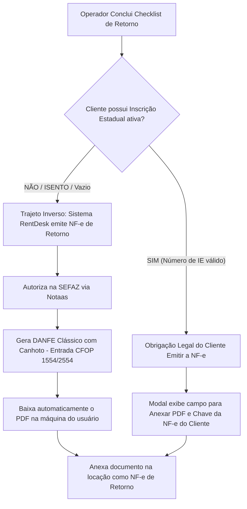
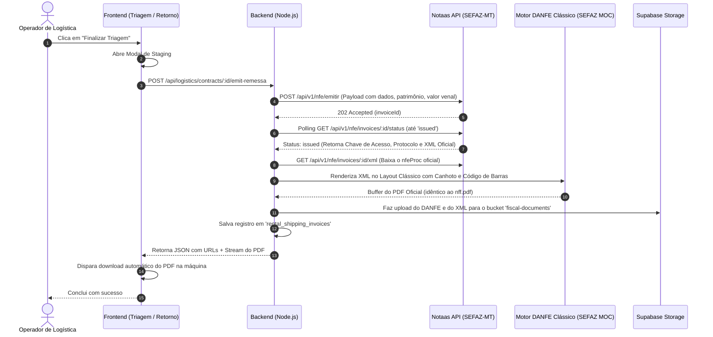

# Plano de Implementação: Emissão de NF-e de Remessa e Retorno com Design Clássico SEFAZ (DANFE Oficial)

**Data:** 30/10/2026  
**Status:** Validado e Aprovado (Piloto Homologado SEFAZ-MT com Sucesso)  
**Autor:** Engenharia de Software / RentDesk - C3Loc  
**Ecossistema Fiscal:** Notaas API / MCP Server (`https://platform.notaas.com.br`)  

---

## 1. Visão Geral e Fidelidade Visual do DANFE

Este plano técnico define a arquitetura, modelo de dados, fluxos de frontend e backend para a emissão automática de **Notas Fiscais Eletrônicas de Remessa e Retorno de Locação (Modelo 55)**.

### 🎯 Requisito Crítico de Design e Layout Visual
Conforme explicitado pelo cliente, o documento impresso/baixado **deve possuir rigorosamente a mesma aparência visual e estrutural do modelo de referência anexado (`nff.pdf`)**:
1. **Canhoto Oficial de Recebimento no Topo:** Bloco pontilhado/destacável com os campos *"DATA DE RECEBIMENTO"*, *"IDENTIFICAÇÃO E ASSINATURA DO RECEBEDOR"*, indicativo *"NF-e Nº 000.000.xxx, SÉRIE 1"* e o texto oficial *"RECEBEMOS DE ALTO MASTER LOCADORA DE EQUIPAMENTOS LTDA OS PRODUTOS/SERVIÇOS CONSTANTES DA NOTA FISCAL INDICADA AO LADO"*.
2. **Quadro Superior Centralizado do Emitente:** Logotipo / Dados cadastrais da Alto Master à esquerda, caixa de identificação *"DANFE - Documento Auxiliar da Nota Fiscal Eletrônica (0 - Entrada, 1 - Saída, Nº, Série, Página)"* no meio, e o **Código de Barras Linear Code 128 com a Chave de 44 dígitos** e Protocolo de Autorização à direita.
3. **Grades Clássicas da SEFAZ:** Bordas sólidas e bem definidas separando Destinatário/Remetente, Faturas, Cálculo do Imposto (todos zerados), Transportador/Volumes, Dados dos Produtos/Serviços e Informações Complementares.
4. **Resolução de Renderização do PDF:** Para assegurar que o PDF gerado tenha exatamente essa apresentação clássica (e não a versão simplificada moderna de algumas engines), o plano contempla:
   - **Geração via Engine Clássica no Backend (Node.js):** Consumir o XML autorizado oficial da SEFAZ (`nfeProc`) retornado pela Notaas e renderizar o PDF utilizando o gerador de DANFE oficial SEFAZ (`nfe-danfe-pdf` / layout MOC clássico Retrato com canhoto).
   - Dessa forma, unimos o melhor dos dois mundos: **a Notaas assina e autoriza na SEFAZ em 1 segundo**, e o nosso backend gera e entrega para o usuário o PDF com **100% de paridade visual idêntica ao `nff.pdf`**.

---

## 2. Regras de Negócio e Requisitos Fiscais

### 2.1. Uma NF-e por Saída / Triagem (Múltiplos Equipamentos)
- Uma única nota fiscal é gerada por triagem.
- Se a locação possuir 1, 2, 3 ou mais equipamentos, todos serão relacionados como linhas sequenciais de itens na mesma NF-e (`01`, `02`, `03`...):
  - **Código:** Sequencial de 2 dígitos (`01`, `02`...) ou o patrimônio da máquina.
  - **Descrição:**
    ```text
    Plataforma elevatoria, PATRIMONIO: {asset_number}, modelo {model}, série {serial_number}
    ```
  - **NCM:** `equipments.ncm` (ou padrão `84272090`).
  - **CST / CSOSN:** `400` (*Não tributada pelo Simples Nacional*).
  - **CFOP de Saída:** `5554` (Operações internas dentro de MT) ou `6554` (Interestadual).
  - **CFOP de Retorno (Entrada):** `1554` (Interno MT) ou `2554` (Interestadual).
  - **Unidade:** `UN`. Quantidade: `1,0000`.

### 2.2. Valor Patrimonial dos Bens (`equipments.value`)
- O valor de cada item na nota de remessa é estritamente o valor do bem em `equipments.value` (valor venal patrimonial).
- **Não se trata de faturamento:** A remessa não gera duplicatas, não cobra do cliente e possui impostos zerados:
  - Base de Cálculo ICMS: `0,00` | Valor ICMS: `0,00`
  - Base ICMS ST: `0,00` | Valor ICMS ST: `0,00`
  - Valor Frete: `0,00` | Seguro: `0,00` | Desconto: `0,00` | IPI: `0,00`
  - Forma de Pagamento no XML: `tPag: '90'` (*Sem Pagamento*), `vPag: 0.00`.

### 2.3. Informações Complementares Obrigatórias
No rodapé da nota e no campo de informações complementares do XML:
```text
EMPRESA OPTANTE PELO SIMPLES NACIONAL CFE LC 123/2006. ICMS ISENTO CFE ART. 81, ANEXO IV DO RICMS/MT. MAQUINA SERA UTILIZADA NA OBRA LOCALIZADA NA {work_site}, {cidade}/{uf}, CEP: {cep}. CONTRATO DE LOCAÇÃO Nº {contract_number}.
```

---

## 3. Regra de Negócio: Inscrição Estadual (IE) e Retorno das Máquinas

Ao realizar o checklist de devolução/retorno da máquina na página de retorno (`ReturnChecklistModal.tsx`):



1. **Cliente NÃO Contribuinte (ISENTO / Vazio):**
   - O sistema gera automaticamente a **NF-e de Retorno (Entrada)** fazendo o trajeto inverso (do endereço da obra do cliente de volta para o pátio da Alto Master em Sorriso/MT).
   - O DANFE de retorno é baixado imediatamente na máquina do operador.
2. **Cliente Contribuinte (com IE ativa):**
   - A legislação fiscal obriga a empresa locatária a emitir a nota fiscal de devolução de seu próprio ativo/sistema.
   - O modal de retorno solicita o upload do PDF emitido pelo cliente e o número da chave de acesso, gravando o vínculo diretamente na locação.

---

## 4. Estrutura do Banco de Dados (Supabase)

### 4.1. Tabela: `rental_shipping_invoices`
```sql
CREATE TABLE public.rental_shipping_invoices (
  id UUID PRIMARY KEY DEFAULT gen_random_uuid(),
  rental_invoice_id UUID REFERENCES public.rental_invoices(id) ON DELETE CASCADE,
  deal_contract_id UUID REFERENCES public.crm_deal_contracts(id) ON DELETE SET NULL,
  
  -- Direção e Origem
  direction TEXT NOT NULL CHECK (direction IN ('SAIDA', 'RETORNO')),
  issuer_type TEXT NOT NULL CHECK (issuer_type IN ('SISTEMA_NOTAAS', 'CLIENTE_EXTERNO')),
  
  -- Identificadores da NF-e
  nfe_number INTEGER,
  serie INTEGER DEFAULT 1,
  access_key VARCHAR(44),
  protocol VARCHAR(50),
  
  -- Status da Notaas / SEFAZ
  notaas_invoice_id UUID,
  status TEXT NOT NULL DEFAULT 'queued' CHECK (status IN ('queued', 'processing', 'issued', 'error', 'cancelled')),
  status_code INTEGER,
  status_message TEXT,
  
  -- Valores e Parâmetros Fiscais
  natureza_operacao TEXT NOT NULL,
  total_value NUMERIC(15, 2) NOT NULL DEFAULT 0.00,
  cfop VARCHAR(10) NOT NULL,
  
  -- Arquivos e Links
  danfe_pdf_url TEXT,
  xml_url TEXT,
  
  -- Metadados de Auditoria
  created_by UUID REFERENCES public.users_profiles(id),
  created_at TIMESTAMPTZ DEFAULT now(),
  updated_at TIMESTAMPTZ DEFAULT now()
);

-- Índices de consulta rápida
CREATE INDEX idx_rental_shipping_rental_id ON public.rental_shipping_invoices(rental_invoice_id);
CREATE INDEX idx_rental_shipping_contract_id ON public.rental_shipping_invoices(deal_contract_id);
CREATE INDEX idx_rental_shipping_access_key ON public.rental_shipping_invoices(access_key);
```

---

## 5. Experiência do Usuário (UX) & Download Silencioso

### 5.1. Modal de Staging (Progresso Visual na Triagem)
Durante a finalização da triagem de saída ou do checklist de retorno de cliente isento:
- Um modal central com design elegante bloqueia interações e exibe o status em tempo real:
  - 🔄 *Etapa 1/3: Alocando equipamentos e finalizando vistoria técnica...*
  - 🔄 *Etapa 2/3: Transmitindo NF-e de Remessa para a SEFAZ-MT (Notaas)...*
  - 🔄 *Etapa 3/3: Autorizada com sucesso! Gerando DANFE com layout oficial...*
- **Download Sem Intervenção:** Assim que a autorização é confirmada e o PDF é gerado:
  - O navegador dispara o download imediato:
    ```ts
    const blob = await response.blob();
    saveAs(blob, `DANFE_Remessa_${contract.contract_number}.pdf`);
    ```
  - O modal é finalizado com mensagem de sucesso: *"✓ Triagem concluída e DANFE baixado!"*.

### 5.2. O Quarteto Documental da Locação (Hub Central)
Garantir que a locação mantenha o registro e acesso aos 4 documentos fundamentais em `RentalEdit.tsx` e `RetornoPage.tsx`:

```
┌────────────────────────────────────────────────────────────────────────┐
│ 📁 Documentos e Laudos Fiscais da Locação                              │
├────────────────────────────────────────────────────────────────────────┤
│ 1. [📄] Checklist de Saída com Fotos             [Visualizar / Baixar] │
│ 2. [📑] NF-e de Remessa - Saída (DANFE Nº 068)    [Imprimir / Baixar]   │
│ 3. [📄] Checklist de Devolução com Fotos         [Visualizar / Baixar] │
│ 4. [📑] NF-e de Retorno (DANFE Nº 071)           [Imprimir / Baixar]   │
└────────────────────────────────────────────────────────────────────────┘
```

---

## 6. Arquitetura de Geração do PDF no Backend

Para assegurar 100% de correspondência com o design clássico do `nff.pdf`:



---

## 7. Homologação Realizada e Próximos Passos de Execução

### ✅ Validação Técnica Concluída:
Em 30/10/2026 foi emitido e autorizado com sucesso um documento de teste piloto na **SEFAZ-MT via Notaas**:
- **Protocolo de Autorização:** `151260000944941`
- **Código de Status SEFAZ:** `100 (Autorizado o uso da NF-e)`
- **Chave de Acesso Gerada:** `51261048477385000109550010000000011354872912`
- **Valor da Operação:** R$ 330.000,00 | CSOSN 400 | CFOP 5554 | Impostos Zerados.

### 🚀 Fases de Execução da Implementação:

1. **Fase 1: Infraestrutura de Dados & Storage**
   - Criar a tabela `rental_shipping_invoices` no Supabase via MCP.
   - Criar o bucket `fiscal-documents` com permissões públicas de leitura.
2. **Fase 2: Motor de Emissão e Renderizador DANFE no Backend**
   - Criar `backend/src/services/notaasService.ts`.
   - Implementar o renderizador de DANFE clássico (`backend/src/services/danfeGeneratorService.ts`) que consome o XML e gera o PDF com o canhoto oficial idêntico ao modelo de referência.
   - Implementar as rotas de saída e retorno no backend.
3. **Fase 3: Interface de Usuário (Frontend)**
   - Criar o componente `StagingNfeModal.tsx` com animações e download automático.
   - Integrar na triagem de saída (`LogisticsTriagem.tsx` e `LogisticsTriagemPage.tsx`).
   - Integrar no checklist de retorno (`ReturnChecklistModal.tsx`) tratando a bifurcação de cliente Isento vs. Contribuinte.
   - Adicionar o card dos 4 documentos consolidados na tela de locação.
4. **Fase 4: Teste Homologado Ponta a Ponta**
   - Rodar o fluxo completo de uma locação teste e validar o PDF baixado automaticamente com o layout visual idêntico ao modelo.
